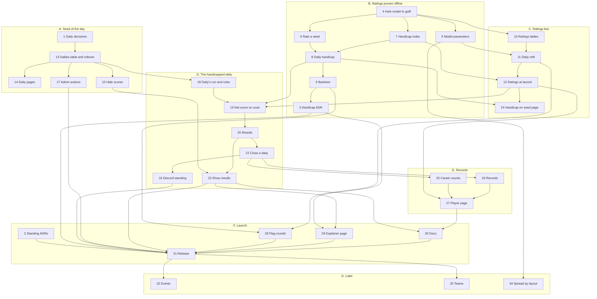

# Competitive play: implementation plan

> **Note**: This document was written by Claude, from a design session with jdharms on
> 2026-11-12, updated for the ratings decisions of 2026-11-17 (design.md, Handicaps). It
> orders the work that takes [design.md](design.md) to production. Tasks
> 1, 13, 14, 15 and 17 are built (2026-11-16), and tasks 3 to 9 (2026-11-17); the
> decisions made while building them are in
> [Decisions made in building](#decisions-made-in-building), to be discussed.

Tasks are numbered for reference, not strictly in the order to do them: the
prerequisites and the graph give the order. Every task that adds a page leaves its
English to jdharms (`server/CLAUDE.md`, "Player-facing text").

## Tasks

### Decisions

| # | Task | Needs |
|---|------|-------|
| 1 | **Done.** Settle the daily's open questions in `design.md` and record them as a proposed ADR. Drafted as ADR 0033: the window, magic words, reruns, bags and the weekly schedule, whose settings live in `schedule.md` | - |
| 2 | Record the standing decisions as proposed ADRs: competition lives on the site; the daily is the unit and there are no seasons; no handicap leaderboard; scores hidden until a player submits, and a closed daily's standing public | - |
| 3 | **Done.** Drafted as ADR 0034. Record the ratings and handicap rules as a proposed ADR once task 9 has set the numbers: the reference holes, mirrored holes pooled, the offline parameters, seed ratings stored at generation, indexes updated on scan, best 8 of the last 10, the starting index, exceptional score reduction, the allowance and its target, the caps, the stroke index order, which rounds count | 9 |

### Ratings engine

| # | Task | Needs |
|---|------|-------|
| 4 | **Done.** Move the hole model out of `tools/spikes/` into `golf/`: one fit with the spread term and the mirrored term, a mirrored hole otherwise unchanged pooled with its unmirrored twin, slot 0 rounds only, taking rounds, seed holes and a parameters file as plain data, with unit tests on synthetic rounds. Predictions on the reference holes give an index, the spread term is centered on them, and the five Mario Open courses' ratings are printed as a check | - |
| 5 | **Done.** Estimate the model's variance components, gamma and the mirrored term offline by EM run to convergence, every parameter together, and store them as a checked-in parameters file the daily refit reads. Report how certain gamma is by resampling players, and whether the mirrored term differs from zero. Compare a single skill for each player with a skill per month or one that drifts, by how far real seeds' course ratings move, and adopt it at a stroke or more | 4 |
| 6 | **Done.** Rate a seed from fitted hole ratings: course rating for an index-0 player, slope against the reference holes, and stroke indexes by rating less par with ties broken by spread, with the baseline fallback for a hole nobody has played | 4 |
| 7 | **Done.** Compute a handicap index from a player's rounds: the best 8 of the last 10, the starting index and its fade, the net double bogey cap, exceptional score reduction, the low mark, its minimum rounds and its caps. Which rounds count is the caller's: on the site, daily rounds only | 4 |
| 8 | **Done.** Compute a daily handicap and its strokes per hole from an index, a seed's ratings and the allowance, including a player better than scratch | 6, 7 |
| 9 | **Done.** A maintained backtest (`golf-ratings backtest`) that replays a site database through tasks 6 to 8 day by day, using only what was known each day. Use it to set the numbers, each starting from the World Handicap System's and changed only when another value wins clearly across resampled rosters (design.md, Setting the numbers): the allowance, the starting index, the caps and the low mark's window and minimum. Test the daily-rounds-only rule and a weekly schedule of modes, report the stroke index order's cost in fairness against ranking by spread, check Sunday Classic rounds against the reference, and set the integrity thresholds | 8 |

### Ratings on the site

| # | Task | Needs |
|---|------|-------|
| 10 | Tables for a ratings run, its hole ratings and each seed's stored ratings (`data_model.md`, Ratings runs) | 4 |
| 11 | The daily refit: at the daily's rollover, in the app's loop that makes the daily (D7), fit the hole ratings under the parameters file and write a run. No timer, no second process; a missed refit leaves the latest run in force | 5, 10 |
| 12 | Ratings at launch: rate every seed already on the site once, under the first run, and from then on rate each new seed when it is generated, under the latest run. Every player's index starts from the starting index and counts only their daily rounds, Milestone A's included (jdharms) | 7, 11 |

### The daily

| # | Task | Needs |
|---|------|-------|
| 13 | **Done.** The `dailies` and `daily_seeds` tables, and a card for each round on an open daily without its handicap fields (`data_model.md`), the checked-in weekday requests and dated overrides, and the job that generates the day's seed at rollover from its request, with a PRNG seed from the date and a server secret, and the date as its magic words (`design.md`, Magic words), which lowers a manifest word's minimum length to 3 while the word bank keeps 4 to 6. Idempotent, so a missed run catches up | 1 |
| 14 | **Done.** The daily on the site (`design.md`, On the site): the Daily Seed on the home page, `/daily` and `/daily/<date>`, the calendar of past dailies with each day's theme and player count, and the daily's mark on its seed page. Each theme's name and optional description are schedule data, stored with the day | 13 |
| 15 | **Done.** Hide a daily's scores from a viewer who has not submitted a round on it: the seed page, other players' round pages and link preview cards | 13 |
| 17 | **Done.** Admin actions for a daily: replace a broken seed, whose magic words drop the weekday and end in `RERUN` (`NOV 16TH RERUN`), at most once a day and only while the day has no card; withdraw a day, as when some players complete it or a replacement breaks too. Through the audit log | 13 |

### Handicapped results

| # | Task | Needs |
|---|------|-------|
| 18 | At rollover, store the daily's rules: the allowance, the Stableford table, the formats, and the index rules its scans apply | 13 |
| 19 | When a scan records a round on an open daily, fill its card: the index the player holds, computed from their counted rounds, the daily handicap, the net score and Stableford points by hole, and the player's index and low mark after the round | 8, 12, 18 |
| 20 | Compute a daily's results under each format: the Stableford standing, every pair's match, and net skins across the field. Formats are separate functions of the field's net scores, so one can be added later. Recomputed when a round arrives, is voided or is restored, before or after close | 19 |
| 22 | Close a daily: stop new cards. A round received later is an ordinary round; a later void or restore still rescores the day | 20 |
| 16 | When a daily closes, post its standing to Discord by webhook: positions, names, Stableford points and skins, with a link to the daily's page. Show the closed daily's standing on its page to every viewer | 22 |
| 23 | Show results: a player's net card with strokes received, their matches, the standing and the skins, on the round page and the daily's page, only to players who have submitted while it is open (task 16 opens the standing at close) | 15, 20 |
| 24 | Show a signed-in player their handicap for any seed on its page, before they play, from their current index and the seed's stored ratings | 8, 12 |

### Records

| # | Task | Needs |
|---|------|-------|
| 25 | Career counts for each player: dailies played, daily wins, match record, skins won, birdies and eagles, rounds under handicap. Counts only, kept current as dailies close and rounds are voided | 22 |
| 26 | Head-to-head and against-the-field records, for a career and by month | 22 |
| 27 | A player's page: index and low mark with their history, career counts and records. Decide whether it is public | 12, 25, 26 |

### Integrity

| # | Task | Needs |
|---|------|-------|
| 28 | Flag for admin review a round far better than the model expected, and a run of rounds far worse, at the thresholds task 9 sets, using the existing flag and void actions | 9, 11 |

### Launch

| # | Task | Needs |
|---|------|-------|
| 29 | A document page on the site explaining handicaps and the daily's formats; jdharms writes it | 3, 23 |
| 30 | Bring the docs up to date: `server/CLAUDE.md`, the data model and routes in `docs/randomizer_devplan.md`, `docs/README.md`, and the spike's README entry once the model has moved | 23, 27 |
| 31 | Release: migrations on production, rating the existing seeds, release notes, the ADRs accepted on merge | 2, 3, 16, 17, 23, 28, 29, 30 |

### Later

| # | Task | Needs |
|---|------|-------|
| 32 | Short opt-in events: several dailies as one tournament, handicaps frozen at its start | 31 |
| 33 | Teams: a daily's field paired for net best ball, or a month between two balanced sides | 31 |
| 34 | At the next re-estimate, test a spread for each layout beyond what its rating predicts, `spread = 1 + gamma * (rating - 4) + extra(layout)`, with the extras a random effect shrunk toward 0, as the month group is: the water-carry hole that separates players more than its difficulty says. `golf-ratings estimate` reports how much layouts' spreads vary and how far real seeds' slopes move. Adopt it if slopes move 0.05 or more and the backtest is clearly fairer (design.md, Fitting) | 5 |

## Milestones

| Milestone | Tasks | What works |
|-----------|-------|------------|
| A. Seed of the day | 1, 13, 14, 15, 17 | The site generates a daily, shows it and hides its scores from players who have not played. No handicaps and no Discord post. This answers the players' request and can ship first |
| B. Ratings proven offline | 4, 5, 6, 7, 8, 9, 3 | Handicaps for every player and every seed can be computed from a database copy, and the numbers are set by backtest |
| C. Ratings live | 10, 11, 12, 24 | Hole ratings refit daily, every seed rated when it is generated, every player has an index, and sees their handicap for any seed |
| D. The handicapped daily | 18, 19, 20, 22, 23, 16 | A daily round produces a net card, a standing, a match against everyone else in the field, and skins, and a closed daily's standing is posted to Discord |
| E. Records | 25, 26, 27 | Career counts, head-to-head and monthly records, and a player's page |
| F. Launch | 2, 28, 29, 30, 31 | Flagging, the explainer, docs and the release |
| G. Events and teams | 32, 33 | Formats layered on the daily |

A and B share no tasks and can go on side by side. C needs B. D needs A and C. E needs
D.

## Dependency graph

## Decisions made in building

Tasks 13, 14, 15 and 17 were built on 2026-11-16, and tasks 4 to 9 on 2026-11-17. These
are the questions that came up and the call Claude made on each, for jdharms to review.
Each is how the code stands.

### The schedule (task 13)

| # | Question | Decision |
|---|----------|----------|
| D1 | Where the weekday requests and dated overrides live | One file, `golf/randomizer/data/daily_schedule.json`: `weekdays` (each of the seven, with a `theme` and a `request`) and `overrides` (by `YYYY-MM-DD`, the same shape). A theme is a `name` and an optional `description`, player-facing text, and the day stores both when it is made, so a later rename leaves past days alone and a rerun keeps the day's. `Schedule.load` refuses a missing weekday, a bad date or theme, or a request that does not check, and a test resolves every weekday |
| D2 | Weights in the schedule's weighted choices | Every choice equally likely |
| D3 | Sunday's "wind profile such as a storm" | Speed is one of the four storms (`storm_rolling_in`, `storm_passing`, `dying_wind`, `back_nine_pressure`); direction stays `vanilla`. The course is one of the US ROM's three (`nes_us`, `nes_uk`, `nes_japan`), equally likely |
| D4 | Saturday's "perhaps a 10-club bag" | Thursday's bag is at most 10 clubs, nothing banned (`"clubs": {"max": 10}`); Saturday sets no club rules |
| D5 | Friday's "any wind" | Every speed profile and every direction profile, equally likely |
| D6 | Derived and community holes | Friday includes derived holes (ADR 0028), which add forward-tee par 3s to its pool. No other day includes any, so they draw vanilla holes only, as a default seed does. No day includes community holes |

### Making a day (task 13)

| # | Question | Decision |
|---|----------|----------|
| D7 | A systemd timer or the app | The app: with `GOLF_DAILY_SECRET` set, the lifespan runs a task that looks every 60 seconds and generates the day's daily in the threadpool if it is not stored. No timer, no second process, and a restart catches up on its first look |
| D8 | Generating ahead of 09:00 | Not done: a day is generated on the first look at or after its opening, so nothing about it exists before it opens. The build takes seconds, and the previous daily is still open for that hour, so the overlap covers it |
| D9 | A day missed entirely, as when the site is down past its close | Skipped: only the day open now is generated. The calendar shows a gap |
| D10 | No secret configured | No dailies are generated and a rerun is refused. The pages work with whatever is stored |
| D11 | The rerun's request | The one stored on the day, not the schedule's current one, so a schedule change in between does not change the rerun's settings. Its PRNG seed hashes the attempt with the date |
| D12 | Storing open and closed | Not stored: a day is open from `opens_at` until `closes_at`. `data_model.md`'s status column became `withdrawn_at`; task 22 adds closed_at when results need fixing |
| D13 | A seed made but its day not stored, if two looks race or a step fails between them | The seed stays an ordinary, unlisted seed, logged. One rollover runs per process, so it should not happen |

### Cards (task 13)

| # | Question | Decision |
|---|----------|----------|
| D14 | Whose rounds get a card | Slot 0 only, a player's own round. A teammate's round played as player 2 on someone's ROM gets none, since the site does not know who played it |
| D15 | A void, then a new round in the freed slot while the day is open | The card passes to the new round; the voided one no longer counts |
| D16 | Rounds that arrive while a day is withdrawn, if it is restored | They get no card, and restoring does not add them |
| D17 | A rerun when a card's round has been voided | Still refused: a card shows the seed could be completed, voided or not. The admin page shows cards beside players for this reason |

### Pages (task 14)

| # | Question | Decision |
|---|----------|----------|
| D18 | The Daily Seed when today's is withdrawn | Withdrawn days are never the Daily Seed: the home page shows the previous day's while it is open, and otherwise none, and `/daily` goes to the calendar |
| D19 | The calendar's shape | A month grid from Monday at `/daily/calendar?month=YYYY-MM`, back to the month of the first daily and forward to the Daily Seed's month; any other month is not found. Each day shows its theme (linking to `/daily/<date>`) and its player count, or that it was withdrawn. The month's name is formatted in the viewer's locale by `localtime.js` (the `calendar_month` filter); the weekday headings are strings |
| D20 | A player count's meaning | Players with a card whose round is still recorded |
| D21 | A link to the daily in the site header | None yet; the home page and the calendar link it. Adding one is a strings key and a line in `base.html`'s nav macros |
| D22 | What a daily's seed page says | A box under the heading: the theme and date and a calendar link, or that it is the rerun, or (on the replaced seed) that it was replaced, linking to the day's seed now. A withdrawn day is marked. The link preview card is unchanged |
| D23 | A theme's optional description | Shown as its own paragraph under the day's name on the home page and the day's seed page, where it has one. The calendar shows names only |

### Hidden scores (task 15)

| # | Question | Decision |
|---|----------|----------|
| D24 | Whether a viewer has played | Their entry on the seed has a recorded round, their own or a teammate's: the rule the seed page already used to open its rounds |
| D25 | Which seeds hide | The day's current seed, while the day's window is open. A replaced seed and a closed day show as any seed. A withdrawn day still hides during its window |
| D26 | The page a scan redirects to (`/r/<id>?recorded`) | Shows the round even to a viewer not signed in, since the phone that scanned may not be. The plain permalink hides it. Hiding is a courtesy against spoilers, not a lock |
| D27 | Hidden on the seed page | The rounds are not sent at all: the section says only that scores show once the viewer submits |

### Admin (task 17)

| # | Question | Decision |
|---|----------|----------|
| D28 | Where the actions live | `/admin/dailies`: the last 60 days with each day's seed, players, cards and status, and Rerun, Withdraw and Restore. The activity log links a daily's actions to its row |
| D29 | The replaced seed's downloads | A rerun withdraws them, in its transaction, so nobody downloads a seed that cannot be completed; the audit log records the seed's withdrawal and the day's replacement |
| D30 | A rerun after the day closes | Refused, since nobody could play it as the day's |
| D31 | Restoring a withdrawn day | Allowed, as for seeds and rounds, in case of a mistake |

### The model (tasks 4 to 6)

| # | Question | Decision |
|---|----------|----------|
| D32 | Where it lives | `golf/ratings/`, numpy only, so the daily refit and the scan can run it on the web server; `golf-ratings fit`, `estimate` and `backtest` drive it from a database copy. Reading the site database is `golf/ratings/sitedb.py`, kept apart so the model takes plain data |
| D33 | One parameters file or two | One, `golf/ratings/data/parameters.json`: the model's numbers, the index rules, the allowance and where the numbers came from, so a ratings run records one hash. `golf-ratings estimate --write` replaces only the model's numbers |
| D34 | How index 0 is pinned | By a constraint in the solve: the hole ratings average par over the reference holes. A player's skill is an unpenalized field term plus their own, ridge-shrunk, so a thin rating is pulled toward the field, not toward scratch. The spike pinned skill 0 to the field instead, and with the spread term that origin drifted: the fit oscillated and never settled. With the constraint it settles in about 11 solves, a second on the 2026-11-17 database |
| D35 | What gamma acts on | A hole's rating, the index-0 player's expectation, less the reference holes' mean par: `spread = 1 + gamma * (rating - 4)`. Then the reference holes' mean spread is exactly 1 and nothing depends on the field |
| D36 | Distance | Centered within its par, at the reference holes' mean distance for that par, so the par terms read as a typical hole and the baseline does not move as the catalog grows. One distance slope for every par, as the spike |
| D37 | Wind | Its speed only, as the spike: 0.009 strokes a hole per unit on the 2026-11-17 database. Direction, and headwind or crosswind against the hole, are left for when Sunday's storms have rounds |
| D38 | A mirror-only hole's twin | The catalog's content hash for the slot's hole id; a hole the catalog does not know stays its own. Only `mirror@` alone pools. A redrawn hole is keyed by the hole it built, so two redraws that build the same hole share a rating, as 709 redrawn slots building 532 distinct holes often do |
| D39 | The mirrored term | Off (`mirror_term: false`). Within the 124 rounds with both kinds, a mirror-only hole plays -0.04 +/- 0.08 strokes a hole against its twin, p = 0.65. Fitted as a term it is -0.18 +/- 0.05, but that error treats holes as independent, and the rounds with mirrored holes were better rounds: played later, by players whose form the one skill does not see. `golf-ratings estimate` reports the paired test, which decides the switch (design.md, Rating holes and courses) |
| D40 | A skill per month | Not adopted. A month's skill varies 0.13 strokes a hole about the player's, and moves live seeds' course ratings 0.19 on average and 0.80 at most, under the stroke that would adopt it. `golf-ratings estimate` reports it each time |
| D41 | Derived holes | Their own layout under their own id, not nested in their base: a forward tee changes the par and the shot, and the baseline rates it until it has rounds. None has been played yet; revisit once Fridays have rounds |
| D42 | Making EM converge | Accelerated by SQUAREM, which extrapolates along two EM steps and falls back on plain EM when the jump fails, to a change under 1e-6 in every log variance and in gamma: 124 steps, about 3 minutes, where plain EM had not settled in 60 |
| D43 | How certain gamma is | Gamma refitted on 100 rosters resampled from the players, with the variances held, by golden-section search below 0.95, past which a par 3's spread nears zero: refitting all of EM for each roster would take hours, and gamma is the number in question. Median 0.51; 90% between 0.35 and the 0.95 ceiling. The model's own error bars are too narrow wherever form matters (D39), so this is the interval to trust |
| D44 | Who a round belongs to | Slot 0 only, as cards (D14) |
| D45 | Withdrawn seeds | Their rounds count: they were played. A seed's withdrawal stops downloads, not the golf |

### The index and the handicap (tasks 7 and 8)

| # | Question | Decision |
|---|----------|----------|
| D46 | A round's differential | (adjusted gross - course rating) / slope, golf's own, which is also exactly the index the model says the round played to |
| D47 | Fixed or recomputed | Fixed (jdharms). A seed is rated once, when it is generated, under the latest run, and its ratings are stored and never redone; a seed made before ratings existed is rated by the launch backfill. A round's differential uses its seed's stored ratings, so it never changes and an index moves only when its player plays. Re-rating would change nothing within a daily, where every player shares the stored rating; it only moved indexes without play, by a median 0.55 and up to 1.4 strokes over four weeks on the 2026-11-17 database. The cost is that a seed rated early keeps an early rating: the backtest, which rates each seed by the model of the day it was made, has a round's spread around its expectation at 6.36 strokes against 6.25 when every seed is re-rated |
| D48 | The hole cap's handicap | The course handicap at 100% from the index the player held before the round, the starting index for a first round. A player better than scratch gives strokes back, which lowers their cap on those holes |
| D49 | The starting index's fade | Half a round of weight with each of the player's own rounds, so it is gone at 8 (design.md, New players) |
| D50 | The low mark | The lowest index held in the 365 days before a round, once the player has 20 counted rounds; the caps apply to the index after each round. Both numbers are the World Handicap System's, confirmed |
| D51 | Rounding | To the nearest stroke, a half up, as golf rounds; a negative handicap gives strokes back from stroke index 18 |
| D52 | Strokes in a match | The weaker player receives the difference of the two daily handicaps, by the seed's stroke indexes |

### The backtest (task 9)

| # | Question | Decision |
|---|----------|----------|
| D53 | Its day | From 09:00 UTC, the daily's rollover; each day's model is fitted on earlier days' rounds once 20 rounds exist, and rates the seeds generated that day, which keep that rating (D47). A round is scored with the index its player holds at scan: every earlier round of theirs counts, that day's included (D64). 262 of 285 rounds are replayed |
| D54 | Which rounds count | Every round on any seed, as if each were a daily: there are no dailies yet. The daily-rounds-only rule cannot be tested until dailies have accumulated; run the backtest again on a database with a month of them |
| D55 | Pairs | Every pair of rounds on a shared seed, each player's handicap from their own scan, as the spike. Fairness is measured at the steady state, both players with 10 earlier rounds, a full record (jdharms): 153 pairs on 2026-11-17. "Stronger" is by the full fit's index, which knows every round |
| D56 | "Clearly" | Better in at least 95% of 1,000 rosters resampled from the players; a pair counts as often as both its players were drawn. Hole ratings are not refitted for each roster |
| D57 | The weekly schedule | Replayed as calibration by the seed's par: round totals less expected are +1.2 strokes on par 54 to 60 seeds and +2.5 on par 70 and over. Both carry an index's optimism (D65), which scales with slope, so Friday's extrapolated slope shows no bias yet. No seed between par 61 and 69 has rounds |
| D58 | The starting index | 0, worth 4 rounds (jdharms). Starting values of +4.5 and +9, and a weight of 2, predict new players' rounds better, +4.5 and 2 clearly, but the starting index is there to keep a strong newcomer from cleaning up, not to predict the typical one, and scratch is the simplest value to explain. A new player's round averages 4.6 strokes worse than their index while it lasts |
| D59 | The integrity threshold | Per index band and measured from the average, set in task 28: a round averages 2.2 strokes worse than its index predicts (D65), with a spread of 6.5 strokes, far wider for weaker players. Measured from the average, no round of 236 was more than 2 spreads better than expected |
| D60 | The spikes | Kept in `tools/spikes/` until task 30: `design.md`'s Evidence section and `player_skill.md` describe them |
| D61 | A conservative gamma | Not adopted. At the steady state the stronger player's match share is 58% at gamma 0.30, 55% at the estimate (0.443), 49% at 0.60 and 41% at 0.85; the first two are within the noise, so the estimate stands. A re-estimate that puts gamma past about 0.6 should send the allowance back to the backtest |
| D62 | When the allowance has drifted | When the middle 90% of the stronger player's share at the steady state, across the backtest's resampled rosters, no longer holds the 55% target (jdharms set the target and the rule: a round allowance, changed only for a new target or a drift, never solved for). Every scheme comparison measures distance from the target, not from 50%. On 2026-11-17 the share is 55%, the range 45% to 63% |
| D63 | Rating a seed nobody has played | As any seed, from its slots: 34 of the 130 live seeds are unplayed, and their holes' unplayed levels leave a median of +/-0.25 strokes in their course ratings, against nearly 0 for played seeds. A derived or community hole nobody has played is rated from par, distance and wind alone |
| D64 | When an index changes | When one of the player's daily rounds is scanned (jdharms): the round is scored with the index they hold, and their index after it is computed from their counted rounds, their seeds' stored ratings and the day's index rules, and stored on the card. With seed ratings stored at generation nothing else changes an index, so no job runs in between. With one daily a day the index a round is scored with is the one its player held when the daily opened; a player who scans the older daily in the hour two overlap carries its update into the newer one. A void or restore changes the player's index from that round on; other cards keep the index they were scored with. The hole ratings still need a daily refit, for new seeds (task 11) |
| D65 | The index rules | Best 8 of the last 10, exceptional score reduction, a starting index of 0 worth 4 rounds, the World Handicap System's caps, and a 90% allowance at the steady state (jdharms). A round thrown by 15 strokes buys 4 to 10 strokes of index over the next 8 rounds, against 13 to 19 with the last 8, and a volatile player's blowups no longer raise their index. An index reads optimistic, as golf's does: a round averages 2.2 strokes worse than it predicts |
| D66 | Exceptional score reduction's reach | The cut applies to every differential in the record, the last 10, so it fades as they age out, as the World Handicap System applies it to the last 20. It is a step at scan, computed from the index the player held: 7.0 to 9.9 strokes better takes 1.0, 10.0 or more takes 2.0 |
| D67 | Milestone A's dailies | They count toward their players' indexes, as the only rounds before launch that do (jdharms ruled out every round on another seed). They are daily rounds, played on the day's seed in its window, and nobody knew when playing them that they would count, so nothing rewarded throwing one; their seeds are rated at launch with the rest. Without them every regular would start launch at scratch with no rounds at all |

### Checked

- **A 3-character magic word on screen.** The menu pads each word to a 6-character slot
  and `MON NOV 16TH` is 12 of the scorecard title's 26 columns. jdharms checked
  `TUES NOV 17TH`, the first daily, in an emulator on 2026-11-17, and it draws correctly.
- **The World Handicap System's low mark.** The USGA's Rules of Handicapping (Rule 5.8)
  establish a Low Handicap Index once a player has 20 acceptable scores, over the 365
  days before their latest one; the soft cap halves a rise past 3.0 and the hard cap
  stops it at 5.0.

