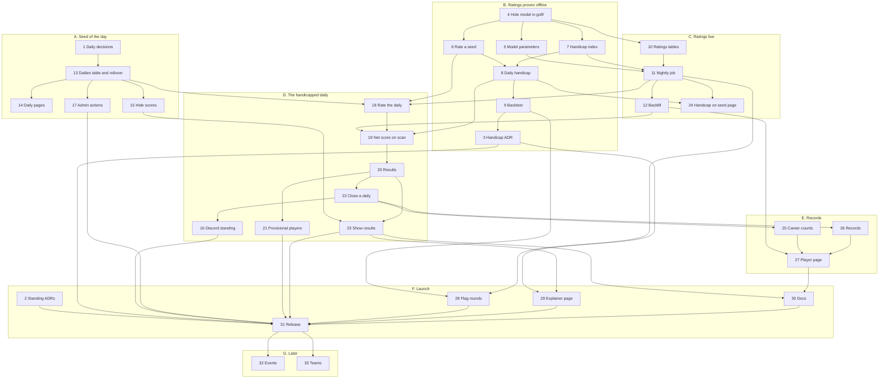

# Competitive play: implementation plan

> **Note**: This document was written by Claude, from a design session with jdharms on
> 2026-11-12. It orders the work that takes [design.md](design.md) to production. Tasks
> 1, 13, 14, 15 and 17 are built (2026-11-16); the decisions made while building them are
> in [Decisions made in building](#decisions-made-in-building), to be discussed.

Tasks are numbered for reference, not strictly in the order to do them: the
prerequisites and the graph give the order. Every task that adds a page leaves its
English to jdharms (`server/CLAUDE.md`, "Player-facing text").

## Tasks

### Decisions

| # | Task | Needs |
|---|------|-------|
| 1 | **Done.** Settle the daily's open questions in `design.md` and record them as a proposed ADR. Drafted as ADR 0033: the window, magic words, reruns, bags and the weekly schedule, whose settings live in `schedule.md` | - |
| 2 | Record the standing decisions as proposed ADRs: competition lives on the site; the daily is the unit and there are no seasons; no handicap leaderboard; scores hidden until a player submits, and a closed daily's standing public | - |
| 3 | Record the handicap rules as a proposed ADR once task 9 has set the numbers: last 8 rounds, the allowance, the caps, the provisional period, which rounds count | 9 |

### Ratings engine

| # | Task | Needs |
|---|------|-------|
| 4 | Move the hole model out of `tools/spikes/` into `golf/`: the fit with the spread term, taking rounds and seed holes as plain data, with unit tests on synthetic rounds | - |
| 5 | Estimate the model's variance components and the spread coefficient offline, and store them as a checked-in parameters file the nightly fit reads | 4 |
| 6 | Rate a seed from fitted hole ratings: course rating, slope and stroke indexes, with the baseline fallback for a hole nobody has played | 4 |
| 7 | Compute a handicap index from a player's rounds: the last 8, the net double bogey cap, the low mark and its caps, the provisional state, and which rounds count: daily rounds, plus the rounds a current player's index is seeded from | 4 |
| 8 | Compute a daily handicap and its strokes per hole from an index, a seed's ratings and the allowance, including a player better than scratch | 6, 7 |
| 9 | A maintained backtest (`golf-ratings backtest`) that replays a site database through tasks 6 to 8 day by day, using only what was known each day. Use it to set the numbers, test the caps, the daily-rounds-only rule and a weekly schedule of modes, and set the integrity threshold | 8 |

### Ratings on the site

| # | Task | Needs |
|---|------|-------|
| 10 | Tables for a ratings run, its hole ratings, each player's index history by run, and the current seed ratings (`data_model.md`, Ratings runs) | 4 |
| 11 | The nightly ratings job: read rounds, fit, write a run and every player's index. A systemd timer in `deploy/`, described in `docs/deployment.md` | 5, 7, 10 |
| 12 | Seed each current player's index from all of their recorded rounds on any seed, so the first daily has handicaps. After it, only daily rounds are added | 11 |

### The daily

| # | Task | Needs |
|---|------|-------|
| 13 | **Done.** The `dailies` and `daily_seeds` tables, and a card for each round on an open daily without its handicap fields (`data_model.md`), the checked-in weekday requests and dated overrides, and the job that generates the day's seed at rollover from its request, with a PRNG seed from the date and a server secret, and the date as its magic words (`design.md`, Magic words), which lowers a manifest word's minimum length to 3 while the word bank keeps 4 to 6. Idempotent, so a missed run catches up | 1 |
| 14 | **Done.** The daily on the site (`design.md`, On the site): the Daily Seed on the home page, `/daily` and `/daily/<date>`, the calendar of past dailies with each day's theme and player count, and the daily's mark on its seed page. Each theme's name and optional description are schedule data, stored with the day | 13 |
| 15 | **Done.** Hide a daily's scores from a viewer who has not submitted a round on it: the seed page, other players' round pages and link preview cards | 13 |
| 17 | **Done.** Admin actions for a daily: replace a broken seed, whose magic words drop the weekday and end in `RERUN` (`NOV 16TH RERUN`), at most once a day and only while the day has no card; withdraw a day, as when some players complete it or a replacement breaks too. Through the audit log | 13 |

### Handicapped results

| # | Task | Needs |
|---|------|-------|
| 18 | At rollover, store the daily's ratings run, its scoring rules, and its seed's course rating, slope and stroke indexes under that run | 6, 11, 13 |
| 19 | When a scan records a round on an open daily, fill its card's index, daily handicap, and net score and Stableford points by hole | 8, 12, 18 |
| 20 | Compute a daily's results under each format: the Stableford standing, every pair's match, and net skins across the field. Formats are separate functions of the field's net scores, so one can be added later. Recomputed when a round arrives, is voided or is restored, before or after close | 19 |
| 21 | Provisional players: shown their own results, left out of the standing, skins and other players' records | 20 |
| 22 | Close a daily: stop new cards. A round received later is an ordinary round; a later void or restore still rescores the day | 20 |
| 16 | When a daily closes, post its standing to Discord by webhook: positions, names, Stableford points and skins, with a link to the daily's page. Show the closed daily's standing on its page to every viewer | 22 |
| 23 | Show results: a player's net card with strokes received, their matches, the standing and the skins, on the round page and the daily's page, only to players who have submitted while it is open (task 16 opens the standing at close) | 15, 20 |
| 24 | Show a signed-in player their handicap for any seed on its page, before they play | 8, 11 |

### Records

| # | Task | Needs |
|---|------|-------|
| 25 | Career counts for each player: dailies played, daily wins, match record, skins won, birdies and eagles, rounds under handicap. Counts only, kept current as dailies close and rounds are voided | 22 |
| 26 | Head-to-head and against-the-field records, for a career and by month | 22 |
| 27 | A player's page: index and low mark with their history, career counts and records. Decide whether it is public | 12, 25, 26 |

### Integrity

| # | Task | Needs |
|---|------|-------|
| 28 | Flag a round far better than the model expected for admin review, at the threshold task 9 sets, using the existing flag and void actions | 9, 11 |

### Launch

| # | Task | Needs |
|---|------|-------|
| 29 | A document page on the site explaining handicaps and the daily's formats; jdharms writes it | 3, 23 |
| 30 | Bring the docs up to date: `server/CLAUDE.md`, the data model and routes in `docs/randomizer_devplan.md`, `docs/README.md`, and the spike's README entry once the model has moved | 23, 27 |
| 31 | Release: migrations on production, the backfill, release notes, the ADRs accepted on merge | 2, 3, 16, 17, 21, 23, 28, 29, 30 |

### Later

| # | Task | Needs |
|---|------|-------|
| 32 | Short opt-in events: several dailies as one tournament, handicaps frozen at its start | 31 |
| 33 | Teams: a daily's field paired for net best ball, or a month between two balanced sides | 31 |

## Milestones

| Milestone | Tasks | What works |
|-----------|-------|------------|
| A. Seed of the day | 1, 13, 14, 15, 17 | The site generates a daily, shows it and hides its scores from players who have not played. No handicaps and no Discord post. This answers the players' request and can ship first |
| B. Ratings proven offline | 4, 5, 6, 7, 8, 9, 3 | Handicaps for every player and every seed can be computed from a database copy, and the numbers are set by backtest |
| C. Ratings live | 10, 11, 12, 24 | Every player has an index that updates nightly, and sees their handicap for any seed |
| D. The handicapped daily | 18, 19, 20, 21, 22, 23, 16 | A daily round produces a net card, a standing, a match against everyone else in the field, and skins, and a closed daily's standing is posted to Discord |
| E. Records | 25, 26, 27 | Career counts, head-to-head and monthly records, and a player's page |
| F. Launch | 2, 28, 29, 30, 31 | Flagging, the explainer, docs and the release |
| G. Events and teams | 32, 33 | Formats layered on the daily |

A and B share no tasks and can go on side by side. C needs B. D needs A and C. E needs
D.

## Dependency graph

## Decisions made in building

Tasks 13, 14, 15 and 17 were built on 2026-11-16. These are the questions that came up and
the call Claude made on each, for jdharms to review. Each is how the code stands.

### The schedule (task 13)

| # | Question | Decision |
|---|----------|----------|
| D1 | Where the weekday requests and dated overrides live | One file, `golf/randomizer/data/daily_schedule.json`: `weekdays` (each of the seven, with a `theme` and a `request`) and `overrides` (by `YYYY-MM-DD`, the same shape). A theme is a `name` and an optional `description`, player-facing text, and the day stores both when it is made, so a later rename leaves past days alone and a rerun keeps the day's. `Schedule.load` refuses a missing weekday, a bad date or theme, or a request that does not check, and a test resolves every weekday |
| D2 | Weights in the schedule's weighted choices | Every choice equally likely |
| D3 | Sunday's "wind profile such as a storm" | Speed is one of the four storms (`storm_rolling_in`, `storm_passing`, `dying_wind`, `back_nine_pressure`); direction stays `vanilla`. The course is one of the US ROM's three (`nes_us`, `nes_uk`, `nes_japan`), equally likely |
| D4 | Saturday's "perhaps a 10-club bag" | Thursday's bag is at most 10 clubs, nothing banned (`"clubs": {"max": 10}`); Saturday sets no club rules |
| D5 | Friday's "any wind" | Every speed profile and every direction profile, equally likely |
| D6 | Derived and community holes | Friday includes derived holes (ADR 0028), which add forward-tee par 3s to its pool. No other day includes any, so they draw vanilla holes only, as a default seed does. No day includes community holes |

### Making a day (task 13)

| # | Question | Decision |
|---|----------|----------|
| D7 | A systemd timer or the app | The app: with `GOLF_DAILY_SECRET` set, the lifespan runs a task that looks every 60 seconds and generates the day's daily in the threadpool if it is not stored. No timer, no second process, and a restart catches up on its first look |
| D8 | Generating ahead of 09:00 | Not done: a day is generated on the first look at or after its opening, so nothing about it exists before it opens. The build takes seconds, and the previous daily is still open for that hour, so the overlap covers it |
| D9 | A day missed entirely, as when the site is down past its close | Skipped: only the day open now is generated. The calendar shows a gap |
| D10 | No secret configured | No dailies are generated and a rerun is refused. The pages work with whatever is stored |
| D11 | The rerun's request | The one stored on the day, not the schedule's current one, so a schedule change in between does not change the rerun's settings. Its PRNG seed hashes the attempt with the date |
| D12 | Storing open and closed | Not stored: a day is open from `opens_at` until `closes_at`. `data_model.md`'s status column became `withdrawn_at`; task 22 adds closed_at when results need fixing |
| D13 | A seed made but its day not stored, if two looks race or a step fails between them | The seed stays an ordinary, unlisted seed, logged. One rollover runs per process, so it should not happen |

### Cards (task 13)

| # | Question | Decision |
|---|----------|----------|
| D14 | Whose rounds get a card | Slot 0 only, a player's own round. A teammate's round played as player 2 on someone's ROM gets none, since the site does not know who played it |
| D15 | A void, then a new round in the freed slot while the day is open | The card passes to the new round; the voided one no longer counts |
| D16 | Rounds that arrive while a day is withdrawn, if it is restored | They get no card, and restoring does not add them |
| D17 | A rerun when a card's round has been voided | Still refused: a card shows the seed could be completed, voided or not. The admin page shows cards beside players for this reason |

### Pages (task 14)

| # | Question | Decision |
|---|----------|----------|
| D18 | The Daily Seed when today's is withdrawn | Withdrawn days are never the Daily Seed: the home page shows the previous day's while it is open, and otherwise none, and `/daily` goes to the calendar |
| D19 | The calendar's shape | A month grid from Monday at `/daily/calendar?month=YYYY-MM`, back to the month of the first daily and forward to the Daily Seed's month; any other month is not found. Each day shows its theme (linking to `/daily/<date>`) and its player count, or that it was withdrawn. The month's name is formatted in the viewer's locale by `localtime.js` (the `calendar_month` filter); the weekday headings are strings |
| D20 | A player count's meaning | Players with a card whose round is still recorded |
| D21 | A link to the daily in the site header | None yet; the home page and the calendar link it. Adding one is a strings key and a line in `base.html`'s nav macros |
| D22 | What a daily's seed page says | A box under the heading: the theme and date and a calendar link, or that it is the rerun, or (on the replaced seed) that it was replaced, linking to the day's seed now. A withdrawn day is marked. The link preview card is unchanged |
| D23 | A theme's optional description | Shown as its own paragraph under the day's name on the home page and the day's seed page, where it has one. The calendar shows names only |

### Hidden scores (task 15)

| # | Question | Decision |
|---|----------|----------|
| D24 | Whether a viewer has played | Their entry on the seed has a recorded round, their own or a teammate's: the rule the seed page already used to open its rounds |
| D25 | Which seeds hide | The day's current seed, while the day's window is open. A replaced seed and a closed day show as any seed. A withdrawn day still hides during its window |
| D26 | The page a scan redirects to (`/r/<id>?recorded`) | Shows the round even to a viewer not signed in, since the phone that scanned may not be. The plain permalink hides it. Hiding is a courtesy against spoilers, not a lock |
| D27 | Hidden on the seed page | The rounds are not sent at all: the section says only that scores show once the viewer submits |

### Admin (task 17)

| # | Question | Decision |
|---|----------|----------|
| D28 | Where the actions live | `/admin/dailies`: the last 60 days with each day's seed, players, cards and status, and Rerun, Withdraw and Restore. The activity log links a daily's actions to its row |
| D29 | The replaced seed's downloads | A rerun withdraws them, in its transaction, so nobody downloads a seed that cannot be completed; the audit log records the seed's withdrawal and the day's replacement |
| D30 | A rerun after the day closes | Refused, since nobody could play it as the day's |
| D31 | Restoring a withdrawn day | Allowed, as for seeds and rounds, in case of a mistake |

### Checked

- **A 3-character magic word on screen.** The menu pads each word to a 6-character slot
  and `MON NOV 16TH` is 12 of the scorecard title's 26 columns. jdharms checked
  `TUES NOV 17TH`, the first daily, in an emulator on 2026-11-17, and it draws correctly.

